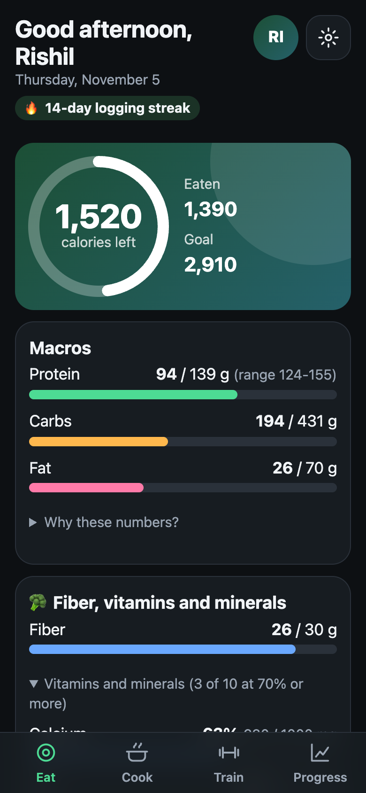
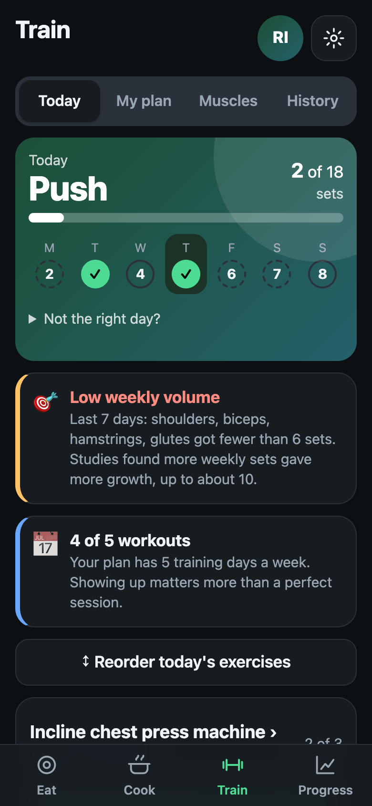
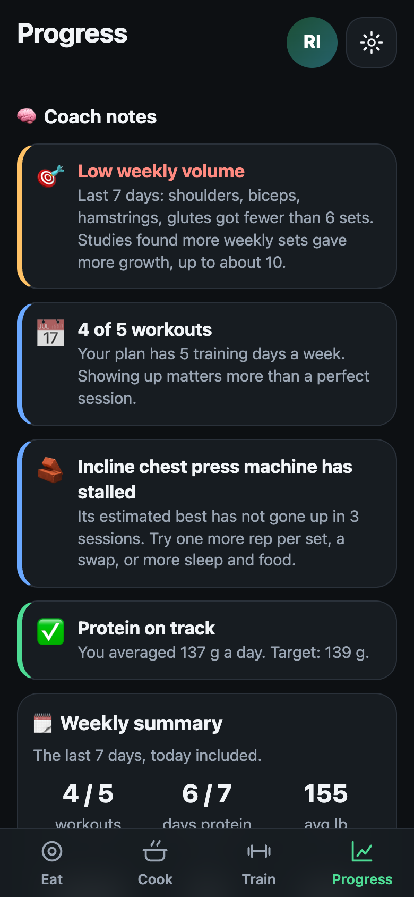

# LiftFuel

A mobile web app for tracking workouts, food and body weight in one place. It installs on an iPhone home screen like a native app and costs nothing to run.

<p align="center">
  
  
  
</p>

## What it does

- **Eat:** calorie and macro targets that adjust to body weight, training days and goal. Search the USDA food database, build meals from ingredients, edit or undo anything you logged, save favorites, and track fiber, vitamins and minerals. After 3 pm it suggests foods for any nutrient that is still low.
- **Train:** a weekly plan with one-tap set logging, suggested weights from your last session, rest timer, plate calculator and drag-to-reorder. Sets logged with no signal are saved on the phone and sync when you are back online.
- **Progress:** weekly summary, strength trends, body weight and measurements, and progress photos with side-by-side comparison.
- **Also:** water goal with bottle buttons, supplements checklist, cardio log, and a recipe finder that fits your remaining calories and protein.

## How it works

- **Frontend:** plain JavaScript (ES modules), no framework and no build step. A service worker makes it installable.
- **Backend:** one Cloudflare Worker with a D1 (SQLite) database. Sign-in is a single passphrase, because the app has one user.
- **Nutrition data:** every calorie, macro and micronutrient number is calculated in code from USDA FoodData Central. A language model on Cloudflare Workers AI only suggests ingredients and amounts for a described dish; it never supplies the nutrition numbers.
- **Training logic:** progressive overload follows a double-progression rule (add weight once every set reaches the top of the rep range). Weekly set targets per muscle come from published volume research, and each exercise is tagged by how strong the evidence behind it is.
- **Cost:** runs entirely on free tiers, with no payment method on any account.

## Run it locally

Needs Node 20 or newer.

```bash
npm install
printf 'PASSPHRASE=dev-pass\nUSDA_KEY=DEMO_KEY\n' > .dev.vars
npm run db:local
npm run dev        # http://localhost:8787, passphrase: dev-pass
```

`DEMO_KEY` is rate limited. Get a free USDA key at https://fdc.nal.usda.gov/api-key-signup for regular use. Recipe and dish suggestions need Workers AI, so they only work once deployed.

## Deploy

1. `npx wrangler login` (a free Cloudflare account is enough)
2. `npx wrangler d1 create gym-food`, then paste the printed `database_id` into `wrangler.toml`
3. `npx wrangler d1 execute gym-food --remote --file=schema.sql`
4. `npx wrangler deploy`
5. `npx wrangler secret put PASSPHRASE` and `npx wrangler secret put USDA_KEY`
6. Open the URL in Safari, then Share and Add to Home Screen.

When a release adds a file to `migrations/`, run it against the remote database before deploying. Settings has a button to download a full JSON backup.

## Tests

```bash
npm test
```

Covers the nutrition math, USDA matching, calorie targets, routine and progression logic, and the weekly summary. They run offline with no network.

## Project layout

```
src/        Worker: API routes, USDA lookup, ingredient matching
public/     The app: one JS module per screen, plus styles and service worker
migrations/ Database changes, applied in order
schema.sql  Full schema for a fresh database
test*.mjs   Unit tests
```

## License

MIT. See [LICENSE](LICENSE).
